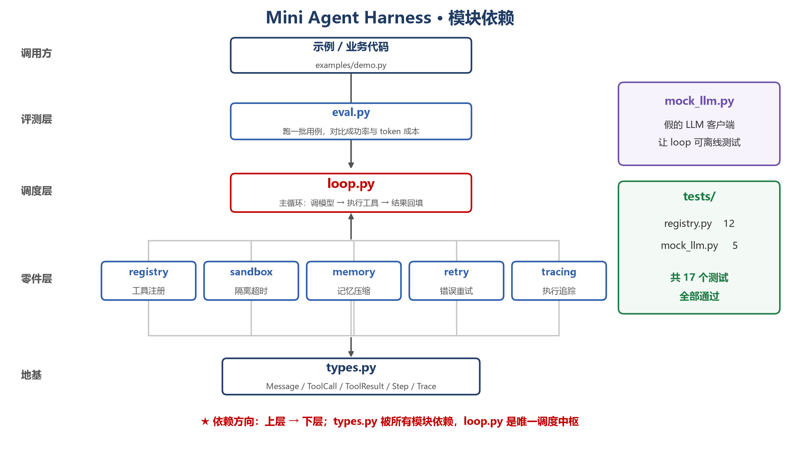
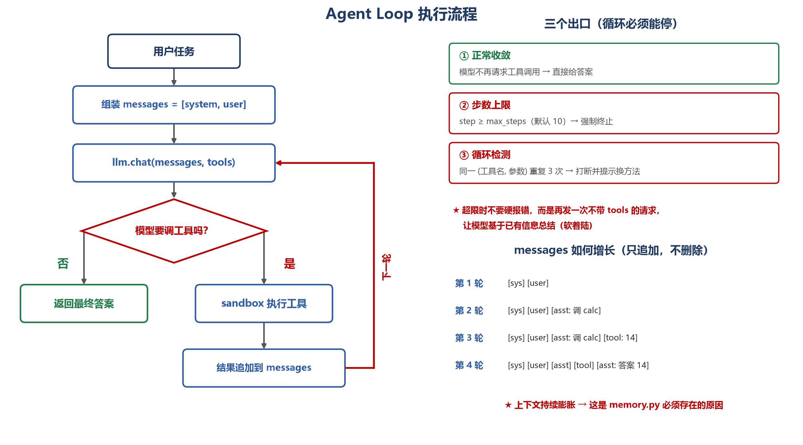

# 04 · Mini Agent Harness

从零实现的**最小 Agent 执行框架**，纯 Python 标准库，**零第三方依赖**。

**56 个单元测试全部通过**，全流程可在无 API Key 的情况下离线运行。

## 为什么写这个

RAG 解决"模型不知道"的问题，Agent 要解决"模型能不能动手"。

本项目把 Agent 的七个核心环节拆开实现，看清**每一层在解决什么、代价是什么**。
相比调用现成框架，从零实现的收获是：**知道每个环节失败时会发生什么。**

## 架构



**依赖方向：上层 → 下层。** `types.py` 被所有模块依赖；`loop.py` 是唯一调度中枢。

## 模块清单

| 模块 | 职责 | 测试 |
| --- | --- | :---: |
| `types` | 核心数据结构：Message / ToolCall / ToolResult / Step / Trace | — |
| `registry` | 工具注册与发现：统一 schema、装饰器注册、按名查找 | 12 |
| `mock_llm` | 假 LLM 客户端：让主循环可离线测试 | 5 |
| `loop` | **Agent 主循环**：调模型 → 执行工具 → 结果回填 → 收敛 | 9 |
| `sandbox` | 工具执行隔离：超时、异常捕获、输出截断 | 6 |
| `memory` | 会话记忆：滑动窗口 + 摘要压缩 | 7 |
| `retry` | 错误分类、指数退避重试、降级兜底 | 6 |
| `tracing` | 执行记录：可序列化、可回放 | 5 |
| `eval` | 评测：对比策略的成功率与 token 成本 | 6 |
| `llm_client` | OpenAI 兼容客户端（DeepSeek / 百炼 / OpenAI），零依赖 | — |

## Agent Loop 如何工作



主循环只有三步：**调模型 → 看它要不要用工具 → 把结果塞回去再调**。

**三个出口**（循环必须能停，否则会跑飞）：

| 出口 | 触发条件 | 处理方式 |
| --- | --- | --- |
| **① 正常收敛** | 模型不再请求工具调用 | 直接返回答案 |
| **② 步数上限** | `step >= max_steps` | **软着陆**：再发一次不带 tools 的请求，让模型基于已有信息总结 |
| **③ 循环检测** | 同一 `(工具名, 参数)` 重复超过阈值 | 打断并软着陆，标记 `stop_reason="loop_detected"` |

## 五个关键设计取舍

### 1. 为什么用「软着陆」而不是硬超时

直接 kill 会让用户拿到**空结果**。软着陆至少能给出**部分答案**，并留下 `stop_reason` 供事后分析。
代价是多一次模型调用。

### 2. 为什么 `messages` 只追加不删除

这是上下文膨胀的根源，**也正是 `memory.py` 存在的理由**。
压缩策略放在 `memory` 里而不是 `loop` 里，是为了让主循环保持"只做调度"。

### 3. 为什么沙箱用「线程 + 软超时」而不是 subprocess

| 方案 | 优点 | 缺点 |
| --- | --- | --- |
| **subprocess（硬隔离）** | 超时能真正杀死进程 | 工具函数必须可序列化（闭包不能用）、跨平台坑多 |
| ★ **线程（软超时）** | 零依赖、跨平台、支持闭包 | **超时后线程无法被强制杀死** |

本项目选线程，是为了**保证测试可写**。生产环境应换 subprocess。
**这个取舍本身比选哪个更重要——面试时可以主动讲。**

### 4. 为什么 `MockLLM` 是必需品而不是玩具

真实 LLM：要 key、要联网、要钱、输出不确定 → **无法写稳定测试**。
`MockLLM` 把"模型会怎么回"变成可预期脚本，于是：
- 能测"模型请求工具 → 工具失败 → 错误回填 → 模型改口"这种路径
- 能断言"第 2 次调用时 messages 里到底有什么"
- 测试 56 个用例，**总耗时不到 1 秒**

### 5. 为什么坚持零依赖

`llm_client.py` 用 `urllib` 手写 HTTP，而不是装 `openai` SDK。
理由是：**能看清 HTTP 层的错误处理**（鉴权失败、限流、超时分别怎么归类），
这对「错误分类 → 重试策略」这条链路是必要的。

## 快速开始

```bash
git clone https://github.com/jinhan-hu/ai-agent-projects
cd ai-agent-projects/04-agent-harness

python tests/run_all.py        # 56 个测试，约 1 秒
python examples/demo.py        # 离线端到端演示（无需 API Key）
python examples/demo.py --real # 接真实模型
```

**接真实模型**（以 DeepSeek 为例）：

```bash
export LLM_BASE_URL=https://api.deepseek.com
export LLM_API_KEY=sk-xxxxxxxx
export LLM_MODEL=deepseek-chat
python examples/demo.py --real
```

### 离线 demo 的实际输出

```
[离线演示] 使用 MockLLM，无需网络

已注册工具：
  - calculator: 计算数学表达式
  - read_file: 读取文本文件

用户任务：帮我算一下 (120 + 80) * 3 等于多少
------------------------------------------------------------
    step 0: 调用 [calculator] -> 1/1 成功
------------------------------------------------------------
最终答案：(120 + 80) × 3 = 600
停止原因：converged
摘要：task='帮我算一下 (120 + 80) * 3 等于多少' | steps=1 | tools=1 | stop=converged
```

## 目录结构

```
04-agent-harness/
├── docs/                 架构图 / 流程图
├── harness/
│   ├── types.py          核心数据结构
│   ├── registry.py       工具注册
│   ├── mock_llm.py       假 LLM
│   ├── loop.py           Agent 主循环
│   ├── sandbox.py        沙箱执行
│   ├── memory.py         记忆管理
│   ├── retry.py          重试与兜底
│   ├── tracing.py        调用追踪
│   ├── eval.py           评测
│   └── llm_client.py     OpenAI 兼容客户端
├── tools/                示例工具
├── tests/                8 个测试文件，56 个用例
└── examples/             可运行示例
```

## 开发进度

| 日期 | 任务 | 状态 |
| --- | --- | :---: |
| 11-02 | 架构定稿 + `types` 补 `tool_calls` + `MockLLM` + 测试 5→12 | ✅ |
| 11-03 | `loop.py` 主循环 + 三个出口 | ✅ |
| 11-04 | `sandbox.py` 超时 / 异常 / 截断 | ✅ |
| 11-05 | `memory.py` 滑动窗口 + 摘要压缩 | ✅ |
| 11-06 | `retry.py` 错误分类 + 指数退避 | ✅ |
| 11-07 | `tracing.py` + `eval.py` | ✅ |
| 11-08 | 串联 + `llm_client` + demo | ✅ |

## 后续可以做什么

- [ ] `sandbox` 换 subprocess 硬隔离，并对比两种方案的耗时
- [ ] `eval` 接入真实模型，跑切分策略 / Agent 策略的对比实验
- [ ] `memory` 加向量检索，做长期记忆
- [ ] 多 Agent 协作（subagent 调度）
