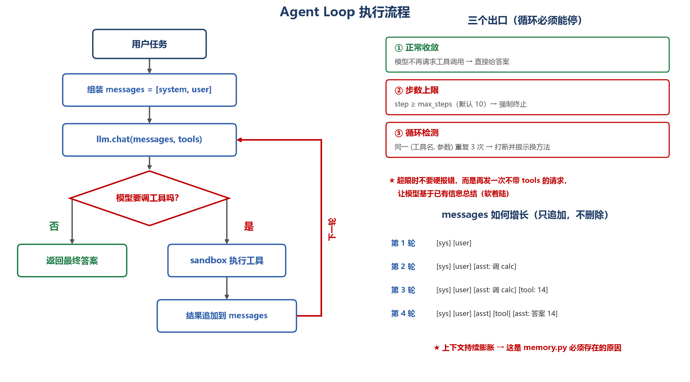

# 04 · Mini Agent Harness

从零实现的**最小 Agent 执行框架**，纯 Python 标准库，零第三方依赖。

## 为什么写这个

RAG 解决"模型不知道"的问题，Agent 要解决"模型能不能动手"。
本项目把 Agent 的七个核心环节拆开实现，看清每一层在解决什么、代价是什么。

## 七个模块

| 模块 | 职责 | 状态 |
| --- | --- | --- |
| `registry` | 工具注册与发现：统一 schema、装饰器注册、按名查找 | 🚧 |
| `loop` | Agent 主循环：思考 → 调用 → 观察 → 收敛 | 🚧 |
| `sandbox` | 工具执行隔离：超时、异常隔离、输出截断 | 🚧 |
| `memory` | 会话记忆：滑动窗口 + 摘要压缩 | 🚧 |
| `retry` | 错误分类、指数退避重试、降级兜底 | 🚧 |
| `tracing` | 每次调用的可回放记录 | 🚧 |
| `eval` | 对比不同策略的成功率与 token 成本 | 🚧 |

## Agent Loop 如何工作



主循环只有三步：**调模型 → 看它要不要用工具 → 把结果塞回去再调**。

循环必须有三个出口，否则会跑飞：

| 出口 | 触发条件 | 处理方式 |
| --- | --- | --- |
| **① 正常收敛** | 模型不再请求工具调用 | 直接返回答案 |
| **② 步数上限** | `step >= max_steps`（默认 10） | **软着陆**：再发一次不带 tools 的请求，让模型基于已有信息总结 |
| **③ 循环检测** | 同一 `(工具名, 参数)` 重复 3 次 | 打断并在 messages 里插入提示，要求模型换方法 |

**两个设计取舍**：

- **为什么不用硬超时**：直接 kill 会让用户拿到空结果。软着陆至少能给出部分答案。
- **messages 只追加不删除**：这是上下文膨胀的根源，也正是 `memory.py` 存在的理由。

## 设计目标

- **零依赖**：clone 即跑，只用标准库
- **可替换**：LLM 客户端抽象成接口，可接任意模型（OpenAI / DeepSeek / 本地）
- **可观测**：每次执行都有完整 trace，可回放定位问题

## 快速开始

```bash
git clone https://github.com/jinhan-hu/ai-agent-projects
cd ai-agent-projects/04-agent-harness
python -m tests.test_registry      # 运行第一个测试
```

## 目录结构

```
04-agent-harness/
├── harness/
│   ├── types.py      # 核心数据结构
│   ├── registry.py   # 工具注册（已实现）
│   ├── loop.py       # Agent 主循环
│   ├── sandbox.py    # 沙箱执行
│   ├── memory.py     # 记忆管理
│   ├── retry.py      # 重试与兜底
│   ├── tracing.py    # 调用追踪
│   └── eval.py       # 评测
├── tools/            # 示例工具
├── tests/            # 单元测试
└── examples/         # 可运行示例
```

## 开发计划

2026-11 阅读周集中开发，逐日推进七个模块。

> 建设中。
