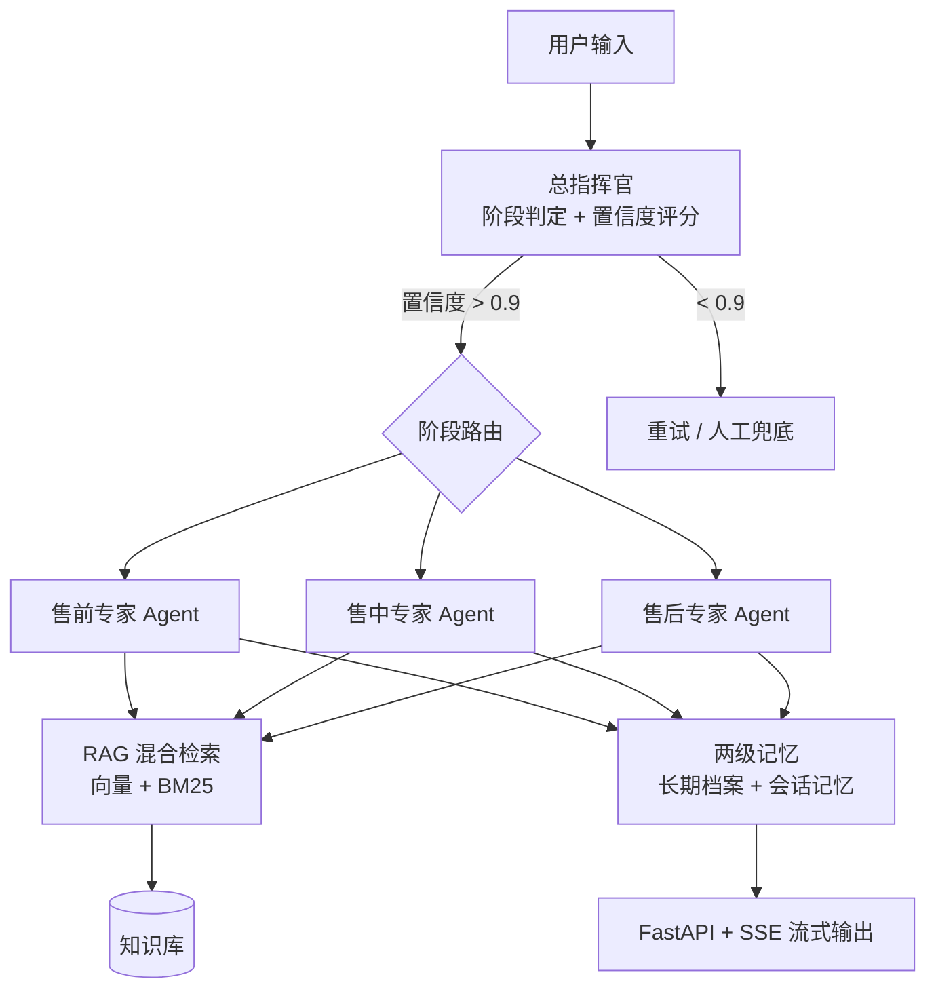
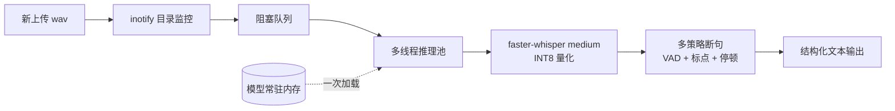
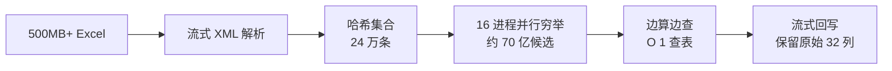

# 架构与设计取舍

## 一、智能销售 Agent：多智能体协作

| 层 | 做法 | 原因 |
| --- | --- | --- |
| 编排 | LangGraph StateGraph + 条件边 | 状态机式路由，可追踪、可回放 |
| 路由 | 置信度阈值 0.9 | 低于阈值触发兜底，避免错误阶段流转 |
| 检索 | 向量 + BM25 混合 | 纯向量在垂直业务术语上存在语义漂移 |
| 记忆 | 长期客户档案 + 短期会话记忆 | 两者生命周期不同，分开存储 |

---

## 二、通话转写系统：资源受限下的推理优化

- **INT8 量化**：内存占用降低约 **50%**
- **模型常驻 + 生产者-消费者**：消除"请求-加载-推理-卸载"的重复加载开销
- **结果**：单通数分钟录音处理压缩至 **约 30 秒**

---

## 三、号码解码引擎：高性能离线数据还原

- 24 万条记录 **100% 还原**
- **流式处理**：全程无全量内存加载
- 零第三方依赖（纯标准库）
